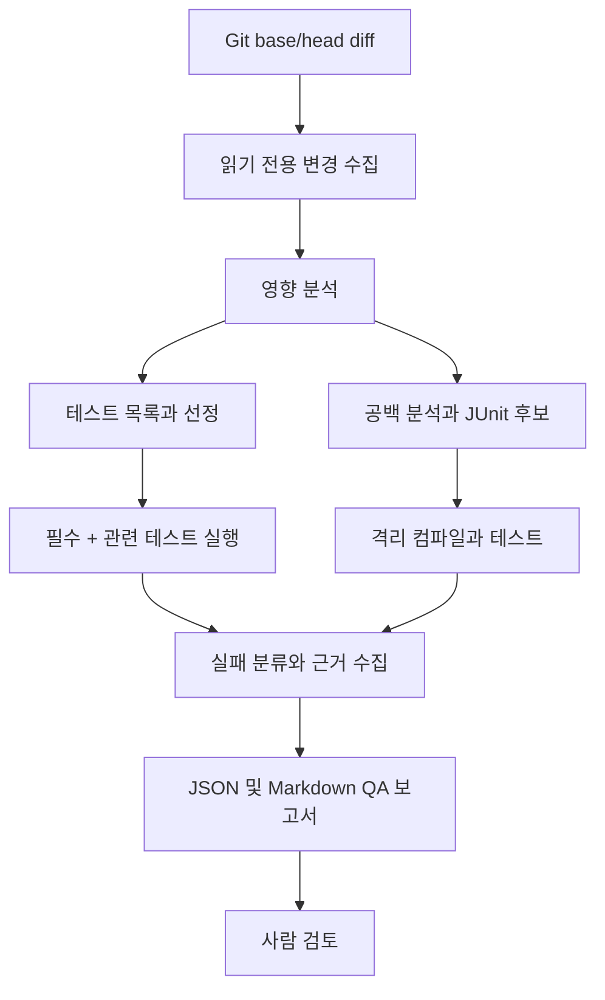

# Agent 아키텍처

[English](architecture.md) | [한국어](architecture.ko.md)

## 목표

`waiting-queue`의 PR diff를 분석해 영향받는 동작을 찾고, 필수·관련 기존 테스트를 실행하며, 빠진 Java/JUnit 테스트를 제안해 격리 검증한 뒤 근거 있는 QA 보고서를 작성합니다. 이 Agent는 회귀 QA 준비를 돕고 배포 안전성을 자동 선언하지 않습니다.

대상 앱 `waiting-queue`는 Java 21, Spring Boot, Gradle, Redis 기반이며 API와 스케줄러 모듈이 있습니다. Agent는 별도의 Python 프로젝트입니다.

## 첫 동작 사이클

변경 사항에 대해 기존 테스트 선정과 공백 분석을 모두 수행합니다. LLM은 필수 테스트를 제거할 수 없습니다. 평가 중에는 전체 스위트를 별도로 실행해 테스트 선정 누락을 측정합니다.

## 단계별 기술

| 구성요소 | 첫 버전 | 후속 확장 |
|---|---|---|
| 인터페이스 | Python CLI | 선택적 FastAPI 작업 API |
| 변경 수집 | 로컬 Git base/head diff | 읽기 전용 GitHub PR 연동 |
| 판단 | 명시적 Python 함수와 검증된 모델 출력 | LangChain 비교, LangGraph 상태·재개 |
| 검색 | 정확한 경로·클래스·메서드·테스트 메타데이터 | 평가 후 RAG/임베딩 도입 |
| 실행 | 격리 작업 복사본에서 허용된 Gradle 테스트 | 자원 제한 컨테이너와 선택적 MCP 도구 |
| 결과 | JSON, Markdown, 로그 | 실행 상태 저장과 OpenTelemetry |

모델 제공자는 구현을 시작할 때 결정합니다. 모델 없이 실행하는 경로와 가짜 응답으로 전체 흐름을 검증할 수 있게 합니다. PostgreSQL/pgvector, 웹 서버, Rust는 첫 버전의 필수 의존성이 아닙니다.

## 경계와 평가

- PR 내용, 소스 주석, 테스트 출력은 명령이 아닌 데이터로 취급합니다.
- 모델이 제공한 임의 셸 명령을 실행하지 않습니다. 저장소·테스트 대상·명령·시간·자원 제한을 검증합니다.
- 생성 코드는 별도 작업 복사본에서 검증합니다. 코드 변경이나 PR 제안은 사람이 검토합니다.
- 공개 토이 앱과 합성 결함 사례를 사용합니다.
- 선정 테스트의 결함 검출을 전체 스위트·주입 결함과 비교합니다. 누락, 생성 테스트 품질, 실행 시간, 모델 비용, 사람의 검토 시간을 기록합니다. 측정 전에는 개선 성과를 주장하지 않습니다.

현재 로컬 기준 테스트에는 스케줄러 실패 2건이 있습니다. Redis 미실행과, 구현은 기본 1개 이동인데 테스트는 3개 이동을 기대하는 불일치입니다. Agent 평가 전에 기존 조건으로 기록합니다.
