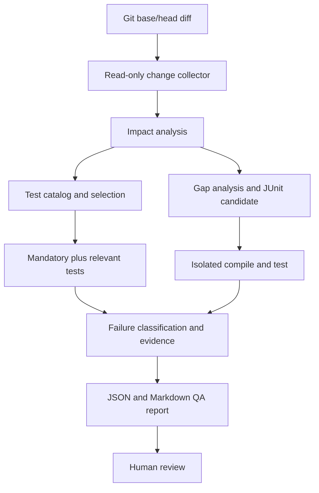

# Agent Architecture

[English](architecture.md) | [한국어](architecture.ko.md)

## Goal

Analyze a `waiting-queue` PR diff, identify affected behavior, run mandatory and relevant existing tests, propose a missing Java/JUnit test, validate that candidate in isolation, and produce an evidence-based QA report. The agent helps prepare regression QA; it does not declare a release safe.

`waiting-queue` is the target system: Java 21, Spring Boot, Gradle, Redis, with API and scheduler modules. The agent is a separate Python project.

## First working cycle

Existing-test selection and gap analysis both run for a change. The LLM cannot remove mandatory tests. During evaluation, run the full suite separately to measure selection misses.

## Technology by stage

| Component | First version | Later extension |
|---|---|---|
| Interface | Python CLI | Optional FastAPI job API |
| Change source | Local Git base/head diff | Read-only GitHub PR integration |
| Decisions | Explicit Python functions and validated model output | LangChain comparison; LangGraph state and resume |
| Retrieval | Exact path, class, method, and test metadata | Evaluate RAG/embeddings before adoption |
| Execution | Allowlisted Gradle tests in an isolated worktree | Bounded container and optional MCP tool |
| Results | JSON, Markdown, logs | Persistent run state and OpenTelemetry |

The model provider is chosen when implementation begins. A model-free path and mock responses keep the workflow testable. PostgreSQL/pgvector, a web server, and Rust are not first-version dependencies.

## Boundaries and evaluation

- Treat PR text, source comments, and test output as data, not instructions.
- Never execute arbitrary shell commands supplied by a model. Validate repo, test target, command, time, and resource limits.
- Validate generated code in a separate worktree. A person reviews any proposed code change or PR.
- Use the public toy app and synthetic defect cases.
- Measure selected-suite defect detection against the full suite and seeded defects. Record false negatives, generated-test quality, run time, model cost, and human review effort. Do not claim measured improvement before collecting results.

The current local baseline has two scheduler test failures: Redis is not running, and a test expects three tokens to move while the implementation defaults to one. Record these as pre-existing conditions before evaluating the agent.
